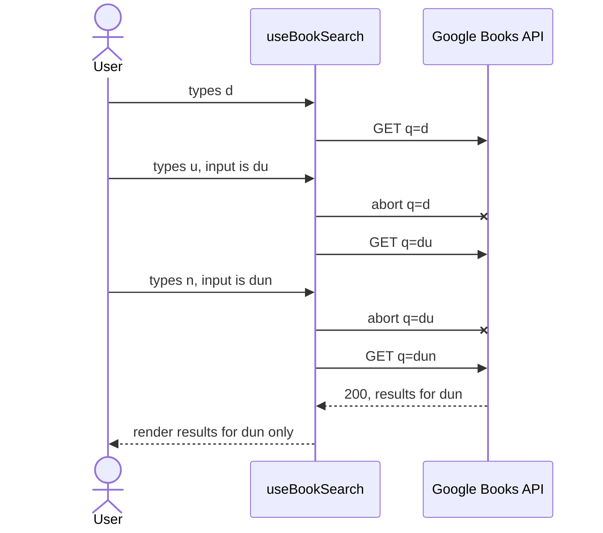

# BookSearch

[](https://github.com/Filippo0311603/book-search-app/actions/workflows/ci.yml)

Search the [Google Books API](https://developers.google.com/books/docs/v1/reference/volumes/list) with live results, pagination and a detail page. Built with Vite, React 19, TypeScript, Redux Toolkit (RTK Query) and Bootstrap 5.3 themed with Sass.

**Live:** [GitHub Pages](https://filippo0311603.github.io/book-search-app/) · **CodeSandbox:** <!-- SANDBOX_URL --> _link added at submission_

## Quick start

Node.js >= 20.19 (`.nvmrc` pins 22).

```bash
npm install
cp .env.example .env   # optional
npm run dev            # http://localhost:5173
```

`.env` can hold `VITE_GOOGLE_BOOKS_API_KEY`. Without it the app sends no `key` parameter, and since the app makes one request per keystroke, Google's shared anonymous quota returns HTTP 429 quickly. Tests need no key: every request is mocked with MSW.

Other scripts: `npm test`, `npm run lint`, `npm run format:check`, `npm run build`, `npm run build:css`.

## Requirements

| Brief item                                  | Where                                                                     |
| ------------------------------------------- | ------------------------------------------------------------------------- |
| `GET /books/v1/volumes?q=…`                 | `searchBooks` in `services/googleBooksApi.ts`                             |
| Live search on every character              | `SearchPage` writes `q` to the URL, `useBookSearch` fetches (no debounce) |
| Pagination with `startIndex` / `maxResults` | `getStartIndex` in `features/books/pagination.ts`                         |
| Page count from `totalItems`                | `getTotalPages`, `getEffectiveTotal`, `applyBounds` (same file)           |
| Page size 5, 10, 15, 20                     | `PAGE_SIZES` in `constants.ts`, `PageSizeSelect`                          |
| Paginator                                   | `components/Paginator.tsx`                                                |
| Detail page with `infoLink`                 | `pages/BookDetailPage.tsx`                                                |
| Missing cover → placehold.co image          | `PLACEHOLDER_COVER_URL`, used by `mappers.ts` and `BookCover`             |
| Description clamped to 2 lines              | `.line-clamp-2` in `styles/_base.scss`, used by `BookCard`                |
| Bootstrap 5.3, Sass theme, responsive       | `styles/_variables.scss` overrides Bootstrap's variables                  |

## Network management

The brief asks for a request per typed character, so the work is keeping that cheap and correct.

- **No debounce.** Every change of the input writes `q` to the URL and starts a search. Whitespace-only input sends nothing.
- **Aborts.** When the arguments change, the in-flight request is aborted through its `AbortSignal` (`useBookSearch`). The abort happens on a real change, not in an effect cleanup, because StrictMode re-runs effects and would cancel its own request.
- **Stale responses.** Cache entries are keyed by `{q, page, pageSize}` and the UI reads only the entry that matches the current arguments, so a late response cannot replace a newer one.
- **Cache.** RTK Query dedupes identical arguments and keeps unused searches and book details for 300 s. Going back to a visited page, or back from the detail page, sends no request.
- **Retries.** Only network errors, timeouts and 5xx are retried (at most 2, exponential backoff). 4xx are final. A 429 is never retried, since that would burn more quota; the UI shows a message and a Retry button. Each request times out after 10 s.
- **No flicker.** While the next page of the same query loads, the previous results stay on screen (dimmed, `aria-busy`). The skeleton shows only on the first load of a query, and the entrance animation plays only for the first results after the home screen.
- **URL as source of truth.** `q`, `page` and `pageSize` live in the query string: replace while typing, push on page changes. Back, forward, refresh and shared links work.
- **`printType=books`.** Every search sends it, because the volumes endpoint also returns magazines by default and the app is about books.
- **Inexact `totalItems`.** Google's total is an estimate. The page count is `ceil(totalItems / pageSize)`, corrected per query by what the fetched pages prove: an empty page or an HTTP 400 on a deep page is the end. "No more results" then offers one click to the last page known to have data.

Typing `dun`; the first two requests are aborted if still in flight and only `dun` is rendered:



## Key trade-offs

- **Search state in the URL, not Redux.** One source of truth, with back/forward and shareable links for free. The Redux slice holds only the preferred page size.
- **No debounce**, as the brief asks. Aborts, the cache and the 429 handling absorb the cost; a 300 ms debounce would cut quota use at the price of a delay.
- **Precompiled, committed CSS.** The free CodeSandbox bundler cannot run Sass. `main.css` is generated from the SCSS and CI fails if the committed copy drifts.
- **Descriptions.** Plain text in lists (needed for the line clamp), DOMPurify-sanitized HTML on the detail page.
- **The API key is public.** In a client-side app, anything in the bundle can be read. The deployed key is restricted to the Books API and, with an HTTP referrer restriction, to the app's domains. A backend proxy holding the key would be the real fix.

## CodeSandbox

The free browser sandbox does not run Vite: it uses CodeSandbox's legacy bundler with the `create-react-app` preset, pinned in `sandbox.config.json`. That bundler cannot compile Sass, so `src/styles/main.css` is precompiled and committed (`npm run build:css`; `dev` and `build` regenerate it, so edit the SCSS, never the CSS). It cannot evaluate `import.meta.env` either, so the key is read as `process.env.VITE_GOOGLE_BOOKS_API_KEY`, which `vite.config.ts` also defines. Icons are inline SVGs (`components/icons.tsx`, from Bootstrap Icons) because the icon font's relative URLs do not resolve there. To use a key in a fork, add a `.env` at its root.

## Tests

`npm test` runs 106 Vitest tests in 11 files with React Testing Library and MSW (`onUnhandledRequest: error`), rendering the app in `StrictMode` with no real network. They cover one request per character with every obsolete one aborted (the handler observes `request.signal`), out-of-order responses, the cache, the retry policy, pagination math and bounds, the mappers, the detail page, theme and keyboard shortcut, accessibility details and the entrance animation. jsdom's own `AbortSignal` is rejected by Node's `fetch`, so tests use a small custom environment (`src/test/jsdom-node-abort.ts`) that adds Node's native one. CI (`.github/workflows/ci.yml`) runs lint, `format:check`, tests, the build and a check that `main.css` is up to date.

## Known limitations

- The 10 s timeout has no dedicated test, and neither has the CSS line clamp or the visual layout.
- "Back to results" relies on router state, which exists only in the tab where the book was opened. A detail page opened in a new tab links back to the plain search page.
- There is no cool-down after a 429: the user can press Retry immediately.
- Treating HTTP 400 on deep pages as "end of results" is defensive; Google does not document it.
- Google's /volumes/{id} can return a Play Store infoLink (a 404) for books that are NOT_FOR_SALE, and cover crops (e.g. 800x128 strips) for large sizes; the app then uses the volume's Google Books previewLink as the "View on Google Books" link, and falls back to the thumbnail and then the placeholder when a cover is not book-shaped (width/height outside 0.4-1.5).

## Project layout

```
src/app/              store, routes, basename
src/services/         RTK Query API (base query, retries, endpoints)
src/features/books/   components, hooks, pagination, mappers, search params
src/components/       layout, search bar, paginator, theme toggle, icons
src/styles/           SCSS partials; main.css is generated and committed
```
