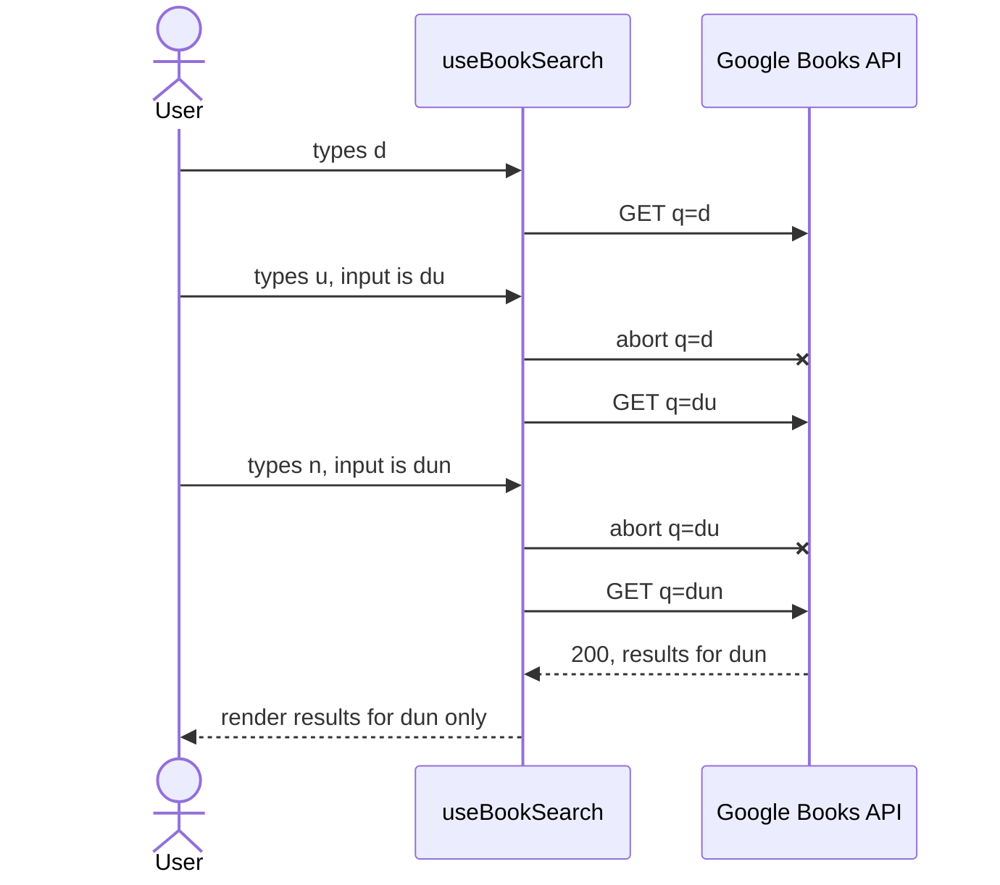

# BookSearch

[](https://github.com/Filippo0311603/book-search-app/actions/workflows/ci.yml)

A responsive single-page app to search books with the [Google Books API](https://developers.google.com/books/docs/v1/reference/volumes/list): live search on every keystroke, dynamic pagination and a detail page, with the network layer (aborts, cache, retries, quota handling) treated as a first-class concern.

|                 |                                                                    |
| --------------- | ------------------------------------------------------------------ |
| **Live demo**   | <https://filippo0311603.github.io/book-search-app/> (GitHub Pages) |
| **CodeSandbox** | see below (the hosting required by the brief)                      |
| **Repository**  | <https://github.com/Filippo0311603/book-search-app>                |

**Live sandbox:** see the link below. <!-- PLACEHOLDER: replace this line with the public sandbox URL before submitting. -->

**Stack:** Vite 7, React 19, TypeScript (strict), Redux Toolkit + RTK Query, React Router 7, Bootstrap 5.3 themed with Sass, Vitest + React Testing Library + MSW.

## Quick start

Requires Node.js >= 20.19 (`engines` in `package.json`; `.nvmrc` pins 22).

```bash
npm install
cp .env.example .env   # optional, see below
npm run dev            # http://localhost:5173
```

**API key (optional).** The app works anonymously, but Google's shared anonymous quota is small and, with one request per keystroke, you will eventually get **HTTP 429** (the UI shows a message and a Retry button). To raise the quota, set `VITE_GOOGLE_BOOKS_API_KEY` in `.env`; the `key` parameter is sent only when the variable is set. Tests need no key (all requests are mocked with MSW).

| Script              | What it does                                                   |
| ------------------- | -------------------------------------------------------------- |
| `npm run dev`       | Vite dev server (bound to all interfaces)                      |
| `npm run build`     | `build:css`, type-check (`tsc -b`) and production build        |
| `npm run build:css` | Compile `main.scss` to `main.css` (automatic in `dev`/`build`) |
| `npm run preview`   | Serve the production build                                     |
| `npm test`          | Vitest once (`test:watch` for watch mode)                      |
| `npm run lint`      | ESLint                                                         |
| `npm run format`    | Prettier (`format:check` only checks)                          |

## Requirements → implementation

| Brief item                                                          | Implementation                                                                                                            | Proof (tests)                                                                                                                                                               |
| ------------------------------------------------------------------- | ------------------------------------------------------------------------------------------------------------------------- | --------------------------------------------------------------------------------------------------------------------------------------------------------------------------- |
| `GET /books/v1/volumes?q=…`                                         | `searchBooks` endpoint in `services/googleBooksApi.ts`                                                                    | `integration`: _searches with the trimmed query and renders the results_                                                                                                    |
| Search bar, **live** on every new character                         | `SearchPage.handleInputChange` → URL → `useBookSearch` (no debounce)                                                      | `network`: _fires one request per typed character and aborts every obsolete one_                                                                                            |
| Pagination with API parameters                                      | `startIndex` / `maxResults` built from `getStartIndex(page, pageSize)`                                                    | `integration`: _sends the right startIndex when navigating with the paginator_; `pagination.test`: _computes startIndex from a 1-based page_                                |
| Dynamic page count from the total                                   | `getTotalPages`, `getEffectiveTotal`, `applyBounds` in `features/books/pagination.ts`                                     | `network`: _derives the page count from the API total, with a windowed paginator_; `pagination.test`                                                                        |
| Page size among [5, 10, 15, 20]                                     | `PAGE_SIZES` (`constants.ts`), `PageSizeSelect`; invalid URL values fall back (`parseSearchState`)                        | `integration`: _refetches with the new maxResults when the page size changes_; `pagination.test`: _rejects unsupported page sizes_                                          |
| Paginator                                                           | `components/Paginator.tsx`, `getPageItems` (first/prev/window with ellipses/next/last)                                    | `pagination.test` (ellipsis cases), `network` (windowed paginator)                                                                                                          |
| Detail page with info and `infoLink`                                | `pages/BookDetailPage.tsx` (`getBook` endpoint, link with `target="_blank" rel="noopener noreferrer"`)                    | `integration`: _renders the book with a safe external link to infoLink_                                                                                                     |
| Missing cover → placehold.co 400x600, `FF5039`, `FFF`, "Book+Cover" | `PLACEHOLDER_COVER_URL` (one constant), used by the mapper and by `BookCover`'s `onError`                                 | `mappers.test`: _falls back to smallThumbnail, then to the placeholder_ ; `BookCover.test`: _falls back to the exact placeholder URL when the image fails, without looping_ |
| Description clamped to 2 lines with "…"                             | `.line-clamp-2` (`-webkit-line-clamp: 2`) in `styles/_components.scss`, used in `BookCard`; HTML stripped in `mappers.ts` | `mappers.test`: _strips HTML from the plain description_ (the CSS clamp is not testable in jsdom)                                                                           |
| Latest Bootstrap, fully responsive                                  | Bootstrap 5.3 grid/utilities, layout checked from 360 px up                                                               | manual check (no automated layout tests)                                                                                                                                    |
| Sass theme colours (nice to have)                                   | `styles/_variables.scss` overrides `$primary`, `$secondary`… before importing Bootstrap                                   | n/a                                                                                                                                                                         |
| Redux, better RTK (nice to have)                                    | `app/store.ts`, RTK Query in `services/googleBooksApi.ts`, `preferencesSlice.ts`                                          | all `network` tests run against the real store                                                                                                                              |
| TypeScript (nice to have)                                           | `strict: true` in `tsconfig.app.json`; `npm run build` runs `tsc -b`                                                      | CI build                                                                                                                                                                    |
| Tailwind/DaisyUI (nice to have)                                     | Not used: Bootstrap is in the required list                                                                               | n/a                                                                                                                                                                         |
| Share on GitHub, host on CodeSandbox                                | Repository and sandbox links above; see [CodeSandbox notes](#codesandbox-notes)                                           | n/a                                                                                                                                                                         |

## Network management

One request per keystroke, as the brief requires, **without debounce**. The cost is traffic against a small quota, so everything below keeps that cost low while keeping the UI correct.

| Concern                 | What happens                                                                                                                                                                                                                                                                                                                                                      | Where                                                            |
| ----------------------- | ----------------------------------------------------------------------------------------------------------------------------------------------------------------------------------------------------------------------------------------------------------------------------------------------------------------------------------------------------------------- | ---------------------------------------------------------------- |
| Request per keystroke   | Every change of the input writes `q` to the URL and triggers a search for the new args; whitespace-only input sends nothing                                                                                                                                                                                                                                       | `SearchPage`, `useSearchState`                                   |
| Obsolete requests       | When the args change (or the query is cleared) the in-flight request is aborted through its `AbortSignal`. Aborting happens only when the args really change, not in an effect cleanup, so StrictMode's effect re-run does not cancel its own request                                                                                                             | `useBookSearch` (`useLazyQuery` trigger + `inFlight` ref)        |
| Stale responses         | Cache entries are keyed by `{q, page, pageSize}` and the UI reads only the entry whose `originalArgs` match the current args, so a late response for an old query can never replace a newer one                                                                                                                                                                   | `useBookSearch` (`isCurrent`)                                    |
| Cache                   | RTK Query dedupes identical args and keeps unused searches and book details for 300 s, so going back to a visited page or query (or back from the detail page) sends no request                                                                                                                                                                                   | `googleBooksApi.ts` (`keepUnusedDataFor`), `trigger(args, true)` |
| Retries                 | Only transient errors (network, timeout, 5xx) are retried, at most 2 times with exponential backoff. 4xx are final, 429 above all (retrying would burn more quota). Aborted requests are never retried                                                                                                                                                            | `baseQuery` + `isRetryableError`                                 |
| Timeout                 | 10 s per request (`TIMEOUT_ERROR`, classified as transient)                                                                                                                                                                                                                                                                                                       | `REQUEST_TIMEOUT_MS`                                             |
| 429                     | Never auto-retried; the user sees "Too many requests…" and a **Retry** button that forces a refetch                                                                                                                                                                                                                                                               | `errors.ts`, `SearchPage`, `useBookSearch.retry`                 |
| No flicker              | While the next page of the same query loads, the previous results stay on screen (dimmed, `aria-busy`); the skeleton shows only on the first load of a query                                                                                                                                                                                                      | `useBookSearch` (`lastShown`)                                    |
| URL as source of truth  | `q`, `page`, `pageSize` live in the query string: **replace** while typing (no history flood), **push** on page changes. Back/forward, refresh and shared links work                                                                                                                                                                                              | `useSearchState`                                                 |
| Inaccurate `totalItems` | Google's total is an estimate. The page count is `ceil(totalItems / pageSize)`, corrected per query by **proven bounds**: an empty page or an HTTP 400 on a deep page is the end; a short page is the end only if it is also the last page by the estimate. "No more results" then jumps in one click to the last page known to have data ("Go to the last page") | `pagination.ts` (`recordPage`, `applyBounds`), `useResultBounds` |

How typing `dun` behaves (the first two requests are aborted if still in flight; only `dun` is rendered):



Network behaviour is tested against MSW with real cancellation: the handler observes `request.signal` aborting (see [Testing](#testing--quality)).

## Architecture

```
src/
  app/                 store (factory), typed hooks, route table, basename, App
  services/            googleBooksApi.ts: RTK Query API (base query, retry policy, endpoints)
  features/books/
    components/        BookCard, BookList, BookCover, BookListSkeleton, BookBackLink, SuggestedSearches
    hooks/             useBookSearch, useResultBounds, useSearchState
    constants.ts       placeholder URL, page sizes, suggested searches
    types.ts           API types (Volume, VolumesResponse) and domain Book
    mappers.ts         Volume -> Book (https covers, HTML stripped/sanitized)
    pagination.ts      pure pagination math and bounds
    searchParams.ts    URL query string parsing/validation
    errors.ts          error classification and messages
    format.ts          publication date formatting
    preferencesSlice.ts
  features/theme/      theme.ts (pure helpers, storage in try/catch), useTheme
  hooks/               useFocusShortcut (the "/" key)
  components/          Layout, SearchBar, ThemeToggle, PageSizeSelect, Paginator, StatusMessage, icons (inline SVG)
  pages/               SearchPage, BookDetailPage, NotFoundPage
  styles/              _variables.scss (theme), _components.scss, main.scss (source), main.css (generated, committed)
  test/                MSW server, fixtures, render helper, setup, jsdom-node-abort environment
```

**Data flow:** URL → `useSearchState` (parse and validate) → `useBookSearch` (lazy trigger, abort, current-args guard) → RTK Query (`googleBooksApi`, cache) → `mappers.ts` (`transformResponse`: raw `Volume` → clean `Book`) → components. Components never see the raw payload and the cache already holds sanitized data.

**Why the URL, not Redux, holds the search state:** back/forward, refresh, shareable links and "detail page, then back to the same results" work without extra code, and there is a single source of truth instead of a store copy to keep in sync. The query string is validated on read (`parseSearchState`). The input text is local state (so a trailing space survives while typing), written to the URL on every change and re-read from it only on navigations other than our own replaces. The detail link carries the results query string in router location state, so "Back to results" returns to the exact view.

**What the Redux slice holds:** only a UI preference, the preferred page size (`preferencesSlice`), used as the default when the URL has none. Everything server-related lives in RTK Query's cache.

## UX & accessibility

| Area        | Details                                                                                                                                                                                   |
| ----------- | ----------------------------------------------------------------------------------------------------------------------------------------------------------------------------------------- |
| Search      | `/` focuses the search box from anywhere outside text fields (hint shown on desktop); suggested searches in the empty state (one click fills and searches)                                |
| Theme       | Light/dark (Bootstrap colour modes): follows the OS, navbar toggle saved in `localStorage` (failures tolerated); an inline script in `index.html` sets it before first paint, so no flash |
| Motion      | Card hover lift and results fade-in, both disabled with `prefers-reduced-motion`                                                                                                          |
| Responsive  | From 360 px up; the paginator stays on one line on phones (first/last buttons hidden below `sm`); crisp large cover on the detail page                                                    |
| Dates       | Readable publication dates (`8 Dec 2015`, `Jun 2017`, `2009`)                                                                                                                             |
| Landmarks   | Skip link, `header` + `nav`, `main`, `footer`, `role="search"`, one `<h1>` per page                                                                                                       |
| Live region | The result count ("Showing X–Y of about Z results") is in an always-mounted `role="status"` / `aria-live="polite"` region                                                                 |
| Focus       | Visible everywhere: one ring on the whole search control, one on the whole card when its title link is focused                                                                            |
| Controls    | Theme toggle is a button with fixed `aria-label` and `aria-pressed`; paginator has labelled buttons and `aria-current="page"`                                                             |
| Contrast    | WCAG AA (at least 5:1) in both themes, measured in the browser for body and secondary text, links, paginator and active page                                                              |

## CodeSandbox notes

**Open it:** <https://codesandbox.io/s/github/Filippo0311603/book-search-app> creates a browser sandbox ("Sandbox (Web)"). To use a key, click **Fork**, then create a `.env` at the root of the fork with `VITE_GOOGLE_BOOKS_API_KEY=<your key>`. Without a key the app still works within the anonymous quota. Browser sandboxes are public, so a `.env` there is readable and the key shows up in request URLs anyway: the real protection is restricting it in Google Cloud Console (Books API only; `*.csb.app` and `filippo0311603.github.io` referrers).

**Why it is set up this way.** CodeSandbox removed the GitHub "Repositories" import (`/p/github/...`) in mid-2026 and Devboxes need paid credits. The free path is the browser sandbox, which does **not** run Vite: it uses CodeSandbox's own bundler with the `create-react-app` preset.

| Choice                                                                                                       | Reason                                                                                                                                              |
| ------------------------------------------------------------------------------------------------------------ | --------------------------------------------------------------------------------------------------------------------------------------------------- |
| `sandbox.config.json` (`create-react-app` template)                                                          | Pins the preset the bundler uses                                                                                                                    |
| Precompiled, committed `src/styles/main.css`                                                                 | The bundler cannot compile Sass (its Sass worker is blocked)                                                                                        |
| `process.env.VITE_GOOGLE_BOOKS_API_KEY`                                                                      | The bundler cannot evaluate `import.meta.env` but exposes `.env` on `process.env`; Vite supports the same form through `define` in `vite.config.ts` |
| Inline SVG icons (`components/icons.tsx`, paths from [Bootstrap Icons](https://icons.getbootstrap.com), MIT) | The icon font's relative URLs do not resolve there                                                                                                  |

`.codesandbox/tasks.json` is unused by the browser sandbox; it is kept for anyone converting the sandbox to a Devbox (installs dependencies, runs `npm run dev` on port 5173; `server.host: true` makes the preview reachable).

Console messages from CodeSandbox's own runtime files (`compile.ts`, `cache.js`, `metrics.js`, "unload is not allowed", a CORS error on `/api/v1/sandboxes/.../cache`) come from CodeSandbox, not from the app.

**Committed CSS.** The SCSS in `src/styles/` is the source of truth; `main.css` is generated by `npm run build:css` (run automatically by `dev` and `build`). Do not edit it by hand: change the SCSS, run `npm run build` and commit both. CI fails if the committed copy drifts.

## Deployment

`.github/workflows/deploy.yml` publishes to GitHub Pages on every push to `main` (and on manual dispatch). The `build` job runs `npm ci`, lint, format check, tests, builds with the base path and uploads `dist`; `deploy` runs only if it succeeds.

- **Secret:** `VITE_GOOGLE_BOOKS_API_KEY` (repository secret passed to the build; optional). Pages Source = GitHub Actions.
- **Base path:** the workflow builds with `BASE_PATH=/book-search-app/`. `vite.config.ts` uses it for Vite's `base` and exposes it as `process.env.BASE_PATH` for the router `basename` (`app/basename.ts`). Unset (local dev, default build, CodeSandbox) it is `/`.
- **Deep links:** Pages has no rewrite rules, so the workflow copies `dist/index.html` to `dist/404.html`; the SPA boots and React Router resolves the URL. Users see the app normally; only crawlers and link checkers see HTTP 404 on deep links.
- **Local check:** Git Bash `MSYS_NO_PATHCONV=1 BASE_PATH=/book-search-app/ npm run build` (otherwise Git Bash rewrites the value into a Windows path); PowerShell `$env:BASE_PATH='/book-search-app/'; npm run build`; then `npm run preview`.

## Testing & quality

`npm test`: **95 tests in 8 files**, all passing. The app is rendered inside `<StrictMode>` like in `main.tsx`, against MSW (`onUnhandledRequest: error`), with no real network.

| File                                               | Tests | Covers                                                                                                                                                                                                                                                                                                                                                                                                                                                                                                                                                |
| -------------------------------------------------- | ----- | ----------------------------------------------------------------------------------------------------------------------------------------------------------------------------------------------------------------------------------------------------------------------------------------------------------------------------------------------------------------------------------------------------------------------------------------------------------------------------------------------------------------------------------------------------- |
| `src/App.network.test.tsx`                         | 29    | One request per character with every obsolete one aborted (the MSW handler observes `request.signal`), out-of-order responses, cache hits, no abort on StrictMode re-runs, whitespace-only input, previous results kept while a page loads, page count from the API total, short/empty/400 pages and one-click landing on a page with data, typing bursts, back/forward, document title; retry policy (5xx retried up to 2 times then error, 200 after a 503, network error retried, 400/404/429 exactly one request, aborted requests never retried) |
| `src/App.integration.test.tsx`                     | 12    | Empty state, trimmed query, page size, paginator `startIndex`, 429 + retry, no results, past-the-end page, return from the detail page, logo reset, detail `infoLink`, unknown book id, 404 route                                                                                                                                                                                                                                                                                                                                                     |
| `src/App.ui.test.tsx`                              | 14    | Theme toggle (OS default, persistence, blocked storage, OS changes), `/` shortcut, suggested searches, live region, skip link                                                                                                                                                                                                                                                                                                                                                                                                                         |
| `src/features/books/pagination.test.ts`            | 21    | `startIndex`, page count, effective total, page window, URL parsing, result bounds                                                                                                                                                                                                                                                                                                                                                                                                                                                                    |
| `src/features/books/mappers.test.ts`               | 6     | https upgrade, cover fallbacks, HTML strip/sanitize, defaults, responses without `items`                                                                                                                                                                                                                                                                                                                                                                                                                                                              |
| `src/features/books/components/BookCover.test.tsx` | 1     | Cover fallback to the exact placeholder URL on image error, no loop                                                                                                                                                                                                                                                                                                                                                                                                                                                                                   |
| `src/features/books/format.test.ts`                | 5     | Publication date formatter                                                                                                                                                                                                                                                                                                                                                                                                                                                                                                                            |
| `src/app/basename.test.tsx`                        | 7     | `BASE_PATH` → router basename                                                                                                                                                                                                                                                                                                                                                                                                                                                                                                                         |

jsdom ships its own `AbortSignal`, which Node's `fetch` rejects, so tests run in a small custom environment (`src/test/jsdom-node-abort.ts`): jsdom plus Node's native `AbortController`/`AbortSignal`, which makes real cancellation observable.

Not covered by automated tests: the 10 s timeout (a retried timeout is classified like a network error but has no dedicated test), the CSS line clamp and visual layout.

**CI** (`.github/workflows/ci.yml`, on push and PR to `main`): `npm ci` → lint → `format:check` → tests → build (`build:css` + `tsc -b` + `vite build`) → check that the committed `src/styles/main.css` is tracked and unchanged (`git diff --exit-code`). The Pages deploy workflow repeats lint, format check and tests before building.

## Design decisions & trade-offs

| Decision                                                                       | Why                                                                                                                 | Alternative                                                                  |
| ------------------------------------------------------------------------------ | ------------------------------------------------------------------------------------------------------------------- | ---------------------------------------------------------------------------- |
| No debounce                                                                    | The brief asks to update on every new character; aborts, cache and 429 handling absorb the cost                     | A debounce (e.g. 300 ms) cuts requests and quota use at the price of a delay |
| Search state in the URL                                                        | Shareable, back/forward and refresh for free, one source of truth                                                   | Keep it in Redux and sync with the URL                                       |
| Abort on args change, not in effect cleanup                                    | Cleanup aborts would also cancel StrictMode's re-issued request for the same args                                   | Abort in cleanup and tolerate/ignore the resulting AbortError                |
| Proven bounds per query                                                        | `totalItems` is an estimate; an empty page or a 400 is the only certain end, so "Last page" lands on real data      | Trust `totalItems`, or cap it artificially                                   |
| Bootstrap 5.3 + Sass                                                           | Required by the brief; theme via variable overrides                                                                 | Tailwind/DaisyUI (listed as nice to have)                                    |
| Precompiled, committed CSS                                                     | The free CodeSandbox bundler cannot run Sass; CI guards against drift                                               | Compile only at build time (breaks the sandbox)                              |
| Inline SVG icons                                                               | The icon font's relative URLs do not resolve in the sandbox                                                         | Bootstrap Icons font                                                         |
| API key in the bundle (`VITE_` variable)                                       | A static front end has no secret store; mitigated by restricting the key to the Books API and to specific referrers | A backend proxy that holds the key                                           |
| Descriptions: plain text in lists, DOMPurify-sanitized HTML on the detail page | Google returns HTML; the list needs text for the line clamp                                                         | Render raw HTML (unsafe)                                                     |

## What I'd do next

- A small backend proxy to keep the API key out of the bundle and to add server-side caching and rate limiting.
- End-to-end tests with Playwright (real browser: layout, line clamp, cover fallback, keyboard flow).
- Test the 10 s timeout path and add visual regression checks (line clamp, layout) in the Playwright suite.
- i18n: messages and date formatting are English only.
- Virtualised lists / infinite scroll if page sizes grow beyond 20.

## Known limitations

- "Back to results" restores the exact search through router state, which exists only in the tab where the book was opened; a detail page opened in a new tab links back to the plain search page.
- Treating HTTP 400 on deep pages as "end of results" is a defensive choice: Google does not document it.
